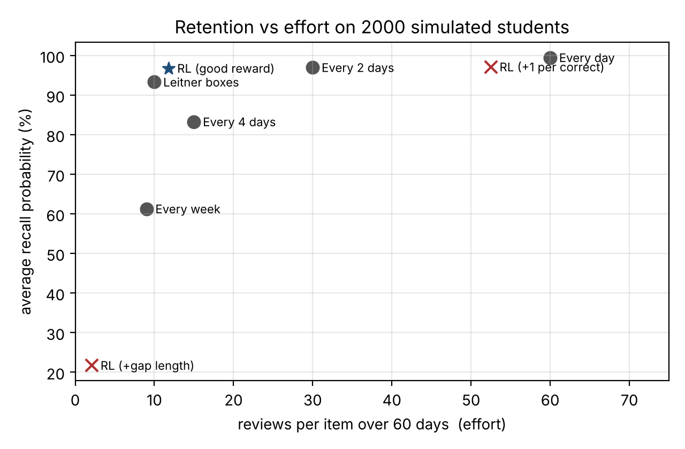

# 🧠 Re-Mind v2 — An Agentic AI Tutor That Learns When You'll Forget

**Winter in Data Science (WiDS) 6.0 · Analytics Club, IIT Bombay**
Mentors: Muhammed Sufiyan & Anshuman Gupta · Domains: Agentic AI + Reinforcement Learning · Level: Intermediate · 5 weeks · ~7 h/week

We forget most of what we learn within days. Spaced repetition fixes this by reviewing material just before you would forget it — but most apps use the same fixed schedule for everyone and every topic. In Re-Mind you build an AI study companion that answers your questions, **decides on its own when and how to test you**, and **gets better at those decisions with reinforcement learning**.

> **What's new vs WiDS 5.0:** last year's tutor quizzed you on a fixed rule (every 5 questions, every 10 minutes, a hand-made level ladder). This year the *schedule itself is learned* by a Q-learning agent — first on thousands of simulated students, then live from your own quiz grades.



*On 2000 simulated students, the learned scheduler keeps **96.8 %** average recall with **11.8** reviews per concept, vs **93.3 %** for Leitner boxes (10 reviews) and **97.0 %** for "review every 2 days" (30 reviews). The red crosses are agents trained on badly designed rewards — they "cheat". You will reproduce this plot in Week 4.*

---

## 🗺️ The 5-week roadmap

| Week | Theme | You build | Deliverable |
|---|---|---|---|
| **1** *(self-paced)* | Foundations: Python, APIs, Gemini, JSON, Streamlit | A Gemini chatbot that remembers every chat | `app.py` |
| **2** | Agentic chatbot | Context, autonomous quizzes (counter + timer), JSON grader, Socratic mode | **Mid-term**: `counterbot.py`, `timebot.py`, `gradebot.py` |
| **3** | RL from scratch | Bandits (ε-greedy, UCB) and Q-learning in a gridworld | 2 notebooks with exercises |
| **4** | Spaced repetition: rules vs RL | Simulated student, Leitner scheduler, Q-learning scheduler, reward hacking | Notebooks + 1-page comparison |
| **5** | RL inside the live tutor | Gemini grades → reward → online Q-learning; benchmark, demo, report | **End-term**: tutor + demo video + report |

Full hour-by-hour plan: [`WEEKLY_PLAN.md`](WEEKLY_PLAN.md) · Reading material: [`docs/remind_handbook.pdf`](docs/remind_handbook.pdf)

## 📁 Repository layout

```
REMIND/
├── week1_foundations/          notebooks + examples/app.py (memory chatbot)
├── week2_agentic_chatbot/      examples/ (context, grader, socratic) + starter/ (mid-term)
├── week3_rl_foundations/       01_bandits.ipynb, 02_q_learning_gridworld.ipynb
├── week4_spaced_repetition_rl/ 01_forgetting_and_leitner.ipynb, 02_rl_scheduler.ipynb
├── week5_rl_tutor/             end-term brief + report template
├── remind/                     the reference package (read it, import it, extend it)
│   ├── memory_model.py         forgetting curve + simulated student
│   ├── env.py                  spaced repetition as an RL environment (gym-style)
│   ├── schedulers.py           fixed / Leitner / RL policies + evaluation
│   ├── rl/                     bandits.py, qlearning.py, gridworld.py
│   ├── llm.py, prompts.py      Gemini wrapper (offline fallback) + prompts
│   └── tutor.py                the agent: memory + scheduler + online learning
├── app/streamlit_app.py        Re-Mind v2 (the final product)
├── scripts/                    train_scheduler.py, benchmark.py, make_figures.py
├── tests/                      pytest suite (runs offline, no API key needed)
└── docs/                       handbook (PDF + LaTeX source)
```

## ⚡ Quick start

```bash
git clone https://github.com/suff-yan/REMIND.git && cd REMIND
python -m venv venv && source venv/bin/activate      # Windows: use WSL, or venv\Scripts\activate
pip install -r requirements.txt
cp .env.example .env                                  # paste your free key from aistudio.google.com
python -m pytest -q                                   # 8 tests, no API key needed
python scripts/train_scheduler.py                     # pre-train the RL scheduler (~5 s)
streamlit run app/streamlit_app.py                    # the full tutor
```

## ✅ Prerequisites
Basic Python (variables, loops, functions, lists, dicts) · comfort with VS Code and a terminal · high-school probability (expected value) · a laptop and a Google account for a free Gemini API key. **No prior ML or RL needed** — everything is taught from scratch.

## 🤝 Rules of the road
- AI assistants are allowed — but you must be able to explain every line you submit. Reports are checked.
- Never commit your `.env` / API key (it's in `.gitignore`).
- Doubts → the WhatsApp group first; someone else probably has the same one.
- Week 1 is self-paced because mentors are in placement season. We're back in full force from Week 2 (and yes, the merch promise stands 😉).

## 📚 Further reading
[FSRS / open-spaced-repetition](https://github.com/open-spaced-repetition) · Sutton & Barto, *Reinforcement Learning: An Introduction* (free online), ch. 2 & 6 · [Gemini API docs](https://ai.google.dev/gemini-api/docs) · [Streamlit chat tutorial](https://docs.streamlit.io/develop/tutorials/chat-and-llm-apps/build-conversational-apps)
